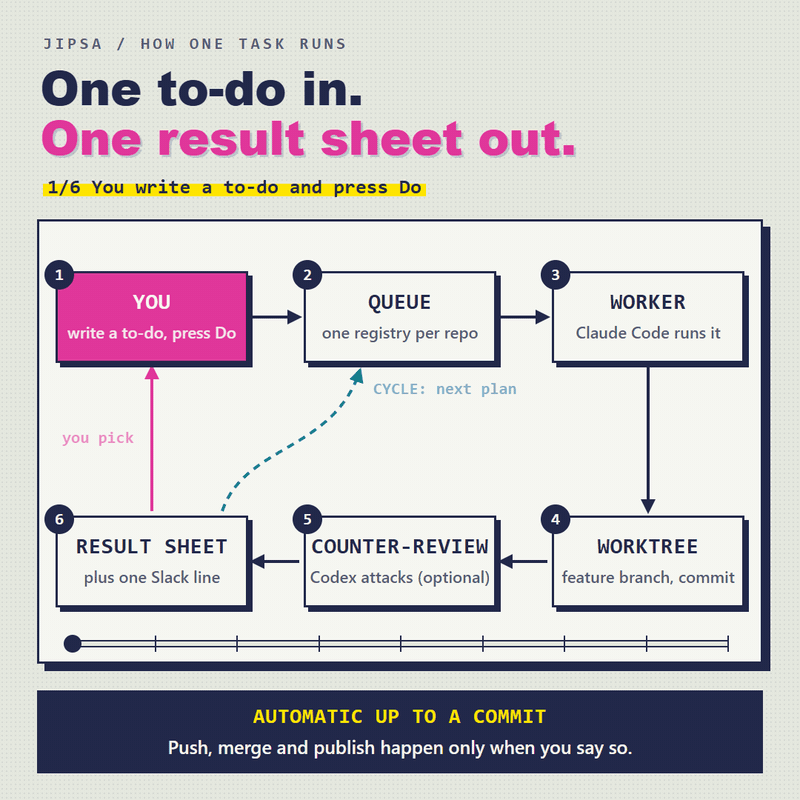
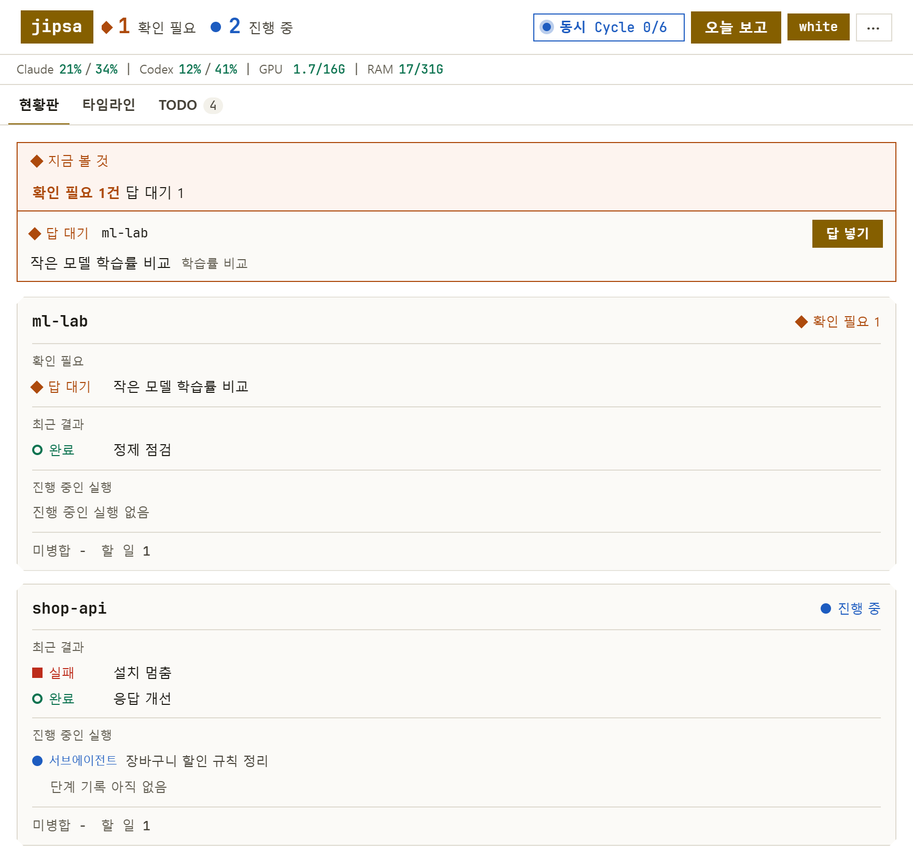
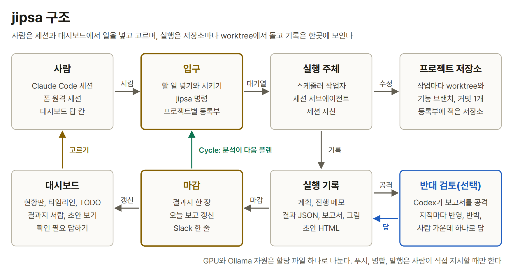
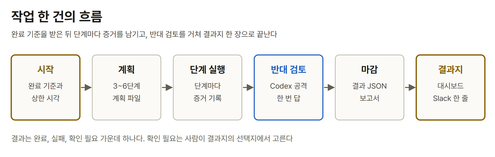

<div align="center">

# jipsa

**A single-user work hub for queuing, running, and picking Claude Code tasks across several repositories from one dashboard screen**

  

[한국어](README.md) | [English](README.en.md)

*The dashboard and the screenshots in this document are in Korean. Screen labels below are given in English with the actual Korean label in parentheses.*





</div>

jipsa is a tool where you write a task on the dashboard and press **Do**; it creates a worktree per repository, a worker carries the task through to a commit on a feature branch, and the result comes back as one result sheet (`결과지`) and one Slack line. Commands are used only for installation and setup; everything else is done on the dashboard.

## Features

- **It goes only as far as can be undone.** The automatic scope ends at a commit on a feature branch. Push, merge, and publish happen only when a person gives the instruction directly.
- **The one who builds and the one who reviews are different.** Claude Code builds, and Codex CLI counter-reviews (`반대 검토`) the report (optional).
- **It does not ask a person; it hands over a result sheet.** Things to decide remain as Needs attention (`확인 필요`) items and options, and you choose on the dashboard.
- **If there is a goal, it keeps running.** A Cycle takes a metric and a target value and repeats run, analysis, and next plan until the deadline.
- **Each repository is worked on separately.** Tasks run in a worktree so the original folder is untouched, and the records are gathered in one place.

## Quick start

On Windows 11 with [uv](https://docs.astral.sh/uv/), git, and the Claude Code CLI installed, five commands open the dashboard. Python 3.12 is found or downloaded by uv. Codex CLI, Ollama, an NVIDIA GPU, and Slack are optional.

```powershell
git clone <this repository> jipsa
cd jipsa
uv sync
uv run jipsa check
uv run jipsa web
```

At http://127.0.0.1:8765/, open the **TODO** tab, enter a project name, and press **Create project** (`프로젝트 만들기`). Write a to-do (`할 일`) on the created row and press **Do**; a worker then works on a feature branch, and when it finishes, the result sheet appears in the Needs attention list. The virtual environment, hooks, folder trust, Slack, the status line, Monitor, the settings skills, and removal are in [Install and first run](docs/getting-started.md) (Korean); how to use each button is in [Using the dashboard](docs/dashboard.md) (Korean); Draft view (`초안 보기`) and a Cycle that runs overnight can be followed through the examples there.

To receive results in Slack, type `/jipsa-slack` in a Claude Code session in the jipsa folder and paste the Slack connection address (Webhook URL). Needs attention and Failed (`실패`) items arrive as a one-line batch as soon as they finish, and the morning summary gathers the Cycles that finished overnight and arrives once a day. Sending a test message and when messages are sent are in [Slack notifications](docs/dashboard.md#7-slack-알림) (Korean).

## Structure

A person queues and picks tasks on the dashboard, execution runs in a worktree per repository, and the records are gathered in one place.



A single task receives its completion criteria, leaves evidence at each step, passes the counter-review, and ends as one result sheet.



<details markdown="1">
<summary>Folder layout</summary>

| Folder | Contents |
| --- | --- |
| `scheduler/` | Commands, scheduler loop, records, reports, dashboard server |
| `web/` | Dashboard screen |
| `adapters/`, `notify/`, `hooks/` | Claude Code and Codex calls, Slack sending, session hooks |
| `projects/` | Registry (`등록부`). Records the automatic scope and forbidden actions per repository |
| `policies/` | Report format, recommendation range, worker permission settings |
| `.claude/`, `CLAUDE.md` | Hook settings the session reads, 8 skills, guidance |
| `RULES.md` | Common rules attached to workers |
| `pyproject.toml`, `uv.lock` | Dependencies and the `jipsa` command entry point, pinned package versions |

`.venv/`, `runs/`, `reports/`, `runtime/`, `worktrees/` are created while running and are not put in git.

</details>

## Documentation

- [Using the dashboard](docs/dashboard.md) (Korean): creating a project, assigning tasks, watching progress, handling Needs attention items, Draft view, Cycle, Slack notifications
- [Install and first run](docs/getting-started.md) (Korean): virtual environment, hooks, Monitor, settings skills, removal
- [Registry format](docs/registry.md) (Korean)
- [To-do file format](docs/todo.md) (Korean)
- [Claude Code integration (hooks, status line, skills)](docs/claude-code.md) (Korean)

## Limitations and license

- Verified only on Windows 11. Path handling and window hiding assume Windows.
- Designed for one person on one machine. Several people sharing the same dashboard is not covered.

MIT license. See [LICENSE](LICENSE).
