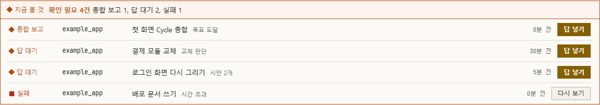
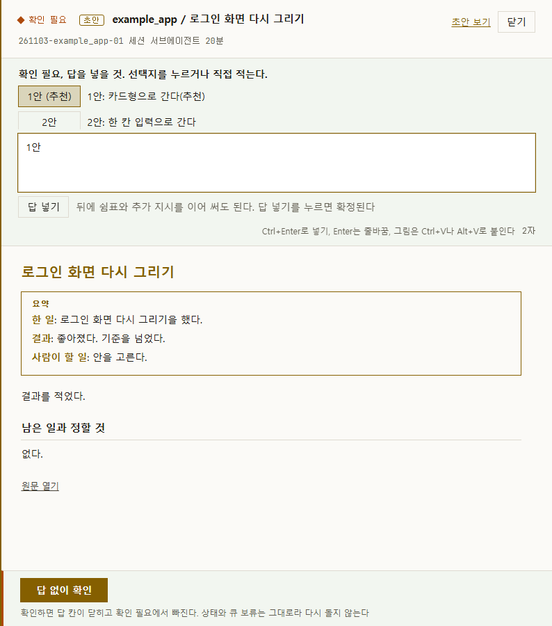
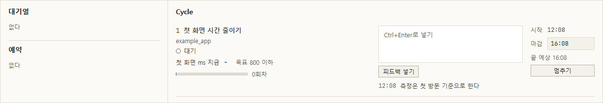

<div align="center">

# jipsa

**여러 저장소의 Claude Code 작업을 대시보드 한 화면에서 넣고, 돌리고, 고르는 1인용 작업 허브**

  

한국어 | English(준비 중)


</div>

jipsa는 대시보드 TODO에 일을 넣고 Do를 누르면, 저장소마다 worktree를 만들어 작업자가 기능 브랜치 커밋까지 하고, 결과를 결과지 한 장과 Slack 한 줄로 돌려주는 도구다. 명령은 설치와 세팅에만 쓰고 나머지는 대시보드에서 한다.

- **되돌릴 수 있는 데까지만 한다.** 기능 브랜치 커밋까지가 자동 범위다. 푸시, 병합, 발행은 사람이 직접 지시할 때만 한다.
- **만드는 쪽과 검토하는 쪽이 다르다.** Claude Code가 만들고 Codex CLI가 보고서를 반대 검토한다(선택).
- **사람에게 묻지 않고 결과지로 넘긴다.** 정할 것은 확인 필요와 선택지로 남고, 대시보드에서 고른다.
- **목표가 있으면 이어 돈다.** Cycle은 지표와 목표값을 받아 실행, 분석, 다음 플랜을 마감까지 되풀이한다.

## 설치와 세팅

요구 사항은 Windows 11, [uv](https://docs.astral.sh/uv/), git, Claude Code CLI다. Python 3.12는 uv가 찾거나 받아 온다. Codex CLI, Ollama, NVIDIA GPU는 선택이다.

```powershell
git clone <이 저장소> jipsa
cd jipsa
uv sync                       # .venv를 만들고 uv.lock에 적힌 버전을 깐다. jipsa 명령도 여기서 생긴다
copy .env.example .env        # 선택. 비워 두면 Slack 없이 파일에만 남는다
uv run jipsa check            # 환경 점검
uv run jipsa web              # 대시보드 http://127.0.0.1:8765/ 와 스케줄러를 함께 켠다
```

가상환경은 직접 만들지 않는다. `.venv`는 git에 들어가지 않고 `uv sync`나 `uv run`이 `pyproject.toml`과 `uv.lock`을 읽어 만든다. Claude Code 훅과 상태 줄이 `.venv`의 파이썬을 바로 부르므로, 이 폴더에서 Claude Code를 열기 전에 `uv sync`를 한 번 돌린다.

받은 폴더에서 Claude Code(`claude`)를 켜면 세션이 안내, 스킬, 훅을 읽으므로 복사할 파일은 없고, 지울 때도 폴더만 지우면 된다([제거](docs/getting-started.md#제거)). 처음 열 때 폴더 신뢰 확인에 동의한다. Slack, Codex, 상태줄처럼 필요할 때만 하는 단계와 임시 폴더로 화면만 먼저 보는 방법은 [설치와 첫 실행](docs/getting-started.md)이다. 훅이 턴 끝을 막거나 코드 수정을 거절하는 이유와 끄는 법은 [Claude Code 연계](docs/claude-code.md)다.

대시보드와 스케줄러를 한 메뉴에서 켜고 끄려면 `uv run python monitor.py`를 쓴다. 창 없는 프로세스라 창을 닫아도 돈다. 설정은 이 폴더에서 연 Claude Code 세션의 스킬로 넣는다.

| 스킬 | 다루는 값 |
| --- | --- |
| `/jipsa-slack` | Webhook 주소, 시험 글, 아침 요약 시각, 알림 켜짐 |
| `/jipsa-model` | 작업자 모델, 가벼운 호출 모델, Codex 모델, 마감 전 공격 공급자 |
| `/jipsa-config` | 동시 작업 수, 자동 작업 동시 수, Ollama 주소, 자료 폴더, 되돌리기 |
| `/jipsa-cleanup` | 기록 보관 기한, 중간 산출물 정리 |

## 1. 프로젝트 만들기

대시보드 **TODO** 탭의 **할 일** 칸 아래 입력에 `my_app`처럼 이름을 넣고 **프로젝트 만들기**를 누른다. 결과와 오류는 입력 아래 한 줄로 보인다. 이 폴더에서 연 Claude Code 세션에 한 줄을 넣어도 같다. 묻는 것은 없다.

```text
/jipsa-register my_app
```

jipsa 폴더와 나란히 `my_app` 폴더가 생기고 git 첫 커밋과 등록까지 끝난다. 종류는 code이고 자동 범위는 기능 브랜치 커밋까지다. 같은 이름의 폴더가 이미 있으면 건드리지 않고 그 폴더를 등록한다. 그 폴더가 git 저장소가 아니면 첫 커밋을 하라는 주의 한 줄이 나온다. 이름은 영문 소문자, 숫자, 밑줄만 쓴다. 잘못된 이름과 이미 등록된 이름은 오류 한 줄로 끝난다. 값을 고치려면 `/jipsa-register my_app edit`, 보려면 `/jipsa-register my_app show`다.

## 2. 작업 시키기

대시보드 **TODO** 탭에서 한다.


1. **할 일** 칸 왼쪽 목록에서 프로젝트를 고른다. 대시보드에서 만든 프로젝트는 바로 골라져 있고, 세션에서 만든 프로젝트는 곧 목록에 나타난다.
2. 입력 칸에 `로그인 오류 고치기 | 로그인 테스트 통과`처럼 할 일과 완료 기준을 적고 **넣기**를 누른다. 기준은 선택이고, 비우면 기준 후보를 정하는 작업이 먼저 돈다. 넣기만 해서는 돌지 않는다.
3. 줄 끝 **Do**를 누르고 확인 창에 동의한다. 줄은 할 일에서 빠지고 "스케줄러에 넣는 중"으로 보인 뒤 현황판에 들어간다. 정한 시각에 돌리려면 **예약**을 눌러 시각(`22:00`, `+30m`)을 적고 **예약하기**를 누른다.

줄을 지우려면 줄 끝 **⋯**의 **지우기**를 누른다. 아직 할 일이 아닌 생각은 아래 **메모**에 넣어 두고 나중에 **할 일로** 올린다. 열린 Claude Code 세션이 답을 기다리는 중이면 Do는 그 세션의 서브에이전트로 가고, 아니면 스케줄러 작업자로 간다.

## 3. 진행 보기

맨 위 줄의 숫자가 지금 확인 필요와 진행 중 수이고, 옆에 지금 도는 일이 보인다. 자세히 보는 곳은 두 탭이다.

- **현황판**: 프로젝트마다 카드 한 장에 확인 필요, 최근 결과, 진행 중인 실행, 미병합 브랜치 수, 할 일 수를 보인다. 일이 없는 프로젝트는 아래 **쉬는 프로젝트**에, 오늘 결과는 **오늘 끝난 일**에 있다.
- **타임라인**: 프로젝트와 작업마다 막대 한 줄이다. 색이 상태이고 위 칩(**진행 중**, **완료**, **실패**, **확인 필요**)으로 거른다. 막대에 마우스를 올리면 단계 이름이 보이고, 누르면 결과지가 열린다.


그날 전체는 오른쪽 위 **오늘 보고**에서 본다.

## 4. 확인 필요 처리

작업자는 사람에게 묻지 않고 멈춰서 결과지로 넘긴다. 끝났는데 아직 보지 않은 결과도 확인 필요로 모인다.

### 어디에 보이나

- 맨 위 줄의 **확인 필요** 숫자. 누르면 현황판 목록으로 간다.
- **현황판** 위 **지금 볼 것** 띠와 그 아래 목록.
- **타임라인**의 주황 막대와 숫자 표식. 실패는 빨간 막대다.



| 목록의 종류 | 뜻 | 줄 끝 단추 |
| --- | --- | --- |
| 답 대기 | 사람이 정해야 작업이 나아간다 | 답 넣기 |
| 종합 보고 | Cycle이 끝나 전체 결과를 냈다 | 답 넣기 |
| 실패 | 작업이 실패했고 아직 보지 않았다 | 다시 보기 |
| 확인 필요 | 끝났고 아직 보지 않았다 | 결과지 |

### 결과지 서랍

단추나 막대를 누르면 오른쪽에 결과지 서랍이 열린다. 위에 답 칸, 가운데 보고서, 바닥에 확인 단추가 있다. 보고서 맨 위 요약 상자가 한 일, 결과, 사람이 할 일을 세 줄로 말한다. 끝에 **원문 열기**가 있다.



### 선택지 고르기

`1안 (추천)`, `2안` 단추를 누르면 답 칸에 안 이름이 채워진다. 누르는 것만으로 확정되지 않는다. 뒤에 `1안, 버튼 색은 파랑으로`처럼 지시를 이어 쓰고 **답 넣기**를 눌러야 확정된다.

### 답 넣기

답 칸에 직접 적고 **답 넣기**(Ctrl+Enter)를 누른 뒤 확인 창에 동의한다. Enter는 줄바꿈이고, 그림은 Ctrl+V나 Alt+V로 붙인다. 넣은 뒤는 작업 주체에 따라 다르다.

- 스케줄러 작업자의 답 대기: 스케줄러가 답을 받아 같은 작업을 이어 돌린다. 세션을 열어 둘 필요가 없다.
- 세션 서브에이전트 작업과 이미 끝난 결과: 그 실행을 다시 돌리지 않고 답을 Claude Code 세션에 넘긴다. 세션이 2분 안에 받지 않으면 스케줄러가 새 작업자 실행으로 넘겨 앞 결과지와 답을 읽고 잇는다. 그래서 대시보드만 써도 답이 처리된다. 작업자는 그 프로젝트 등록부의 허용 범위 안에서만 일하고, 범위 밖이면 확인 필요로 돌아온다.
- 자동으로 넘어가지 않는 답: 세션 전용 프로젝트(`manual_only`)의 답과 1시간 넘게 묵은 답(스케줄러가 꺼져 있던 사이의 답)은 세션이 받을 때까지 기다린다. 결과지에 "아직 처리되지 않았다"는 줄과 사유가 보인다. 묵은 답을 지금 돌리려면 `uv run jipsa answer <실행ID> --undo`로 물린 뒤 다시 넣는다.

### 답 없이 확인

읽기만 하고 정하지 않을 때 서랍 바닥 단추를 누른다.

- **답 없이 확인**(답 대기 작업): 답 칸이 닫히고 확인 필요에서 빠지며 상태가 **확인함**이 된다. 작업은 다시 돌지 않는다.
- **확인**(끝난 결과): 확인 필요에서 빠진다. 실패도 확인하면 완료로 처리되고 원래 사유는 결과지에 남는다.
- **확인 필요로 되돌리기**: 확인한 뒤 바닥에 나온다. 누르면 확인 필요로 돌아오고 답 칸이 다시 열린다.

### 초안 보기

초안은 보고서와 따로 작업자가 만든 HTML 결과물이다. 보고서가 무엇을 했고 무엇을 정할지 말한다면, 초안은 화면 시안이나 문서 시안처럼 사람이 눈으로 보고 고를 실물이다. 실행 폴더 안에 저장된다.

- **만들기**: 할 일에 `로그인 화면 HTML 초안 두 안`처럼 적고 **Do**를 누른다. 문장이나 기준에 초안이 있으면 초안 작업으로 돌고, 작업자가 만든 HTML 경로가 결과 파일의 `preview_url`에 없으면 끝나지 않는다. 스케줄러 작업자는 한 번 돌려보내고, 그래도 비면 확인 필요로 끝난다. 세션은 마감이 막힌다.
- **초안으로 치지 않는 줄**: `초안 보기 고쳐 줘`처럼 기능을 말하는 문장, `설계초안.md`처럼 파일 이름, `지난 초안 읽고 요약해 줘`처럼 있는 초안을 읽는 문장, Cycle 줄이다.
- **열기**: 서랍 오른쪽 위 **닫기** 옆 **초안 보기**를 누르면 새 탭에서 열린다. 실행 폴더 안의 파일은 대시보드가 내준다. 그 밖의 `file:` 주소는 브라우저가 막으므로 누르면 주소를 복사하고, 그 주소를 주소창에 붙여 넣는다.
- **고르기**: 초안을 본 뒤 서랍으로 돌아와 선택지를 고르거나 답을 넣는다.
- **표시**: 초안으로 돈 작업은 제목 앞과 **오늘 끝난 일** 줄에 **초안** 표식이 붙는다. 주소가 비면 **초안 주소 없음**, 미리보기 서버가 응답하지 않으면 **미리보기 꺼짐**이 보인다.

## 5. Cycle

지표와 목표값을 주면 실행, 분석, 다음 플랜을 마감까지 되풀이한다. 순서는 일회성 작업과 같고 모두 TODO 탭에서 시작한다.

### 목표 넣기

두 방법 가운데 하나를 쓴다.

- 넣을 때 적는다: `첫 화면 시간 줄이기 | 첫 화면이 0.8초 안에 뜬다 | cycle 첫 화면 ms 800 이하 상한 4`. `상한 N`은 나아지지 않은 Cycle을 몇 번 연속까지 볼지이고 선택이다.
- 넣은 줄을 바꾼다: 줄 끝 **⋯**의 **Cycle**을 누른다. 지표와 목표값은 첫 분석이 정해 그 줄에 채운다. 다시 누르면 꺼진다.
- 값을 고친다: 줄 끝 **⋯**의 **Cycle 값 고치기**를 누르고 지표, 목표값, 방향, 상한, 끝 조건을 고쳐 **저장**한다. 비운 칸은 첫 분석이 정한다. 도는 줄은 "도는 중이다"로 거절되고 값이 그대로다. **멈추기**로 줄이 할 일로 돌아온 뒤 고치고 **Do**로 잇는다.

Cycle 줄은 번호 왼쪽에 **C**가 붙고, 마우스를 올리면 지표와 목표값이 보인다. **할 일** 머리의 **Cycle** 단추로 이 줄만 볼 수 있다.

### 시작과 마감 정하기

- 지금 시작: **Do**를 누르면 줄 아래 **마감** 칸이 열린다. 기본값은 `07:00`이고 `+4h`처럼도 적는다. **시키기**를 누른다.
- 나중에 시작: **예약**을 누르고 **시각**과 **마감**을 적은 뒤 **예약하기**를 누른다. 예약은 위 띠를 펼쳐 **빼기**로 거둔다.

### 진행 보기

TODO 맨 위 띠의 **펼치기**를 누르면 **대기열**, **예약**, **Cycle** 칸이 나온다. Cycle 칸에는 지금 단계, 지표의 지금 값과 목표, 회차, 시작에서 마감까지 지난 비율, 회차별 값 그래프가 있다.



**타임라인**에는 목표 줄이 생겨 처음 값, 최고 값, 목표, 지금 위치를 보이고 그 아래에 회차별 막대가 놓인다. **현황판** 카드에는 **Cycle 목표**가 보인다.

### 피드백과 마감 고치기

- 피드백: Cycle 칸의 글 칸에 적고 **피드백 넣기**(Ctrl+Enter)를 누른다. 돌고 있는 단계에는 다음 구간부터 닿고 다음 분석과 명령에도 들어간다. 지표와 목표값은 바뀌지 않는다.
- 마감: Cycle 칸의 **마감** 값을 `HH:MM`이나 `+2h`로 고치고 Enter를 누른다. 돌던 단계는 끊지 않는다.

### 멈추기

Cycle 칸의 **멈추기**를 누르고 확인 창에 동의한다. 돌던 단계는 끝까지 두고 마감 결과지를 쓴 뒤 줄이 할 일로 돌아온다. 한 번 돈 줄은 **할 일** 머리의 **지난 Cycle**에 있고, **Do**를 누르면 멈춘 자리부터 잇는다.

### 끝난 결과지 보기

끝나면 현황판 목록과 타임라인 목표 줄 아래에 **종합 보고**가 확인 필요로 뜬다. **답 넣기**를 눌러 서랍을 열고, 읽기만 했으면 바닥 **확인**, 덧붙일 지시가 있으면 답 칸에 적어 **답 넣기**를 누른다. 지난 회차의 단계도 타임라인 막대를 눌러 결과지로 본다.

## 구조

사람은 대시보드에서 일을 넣고 고르며, 실행은 저장소마다 worktree에서 돌고 기록은 한 곳에 모인다.


작업 한 건은 완료 기준을 받은 뒤 단계마다 증거를 남기고, 반대 검토를 거쳐 결과지 한 장으로 끝난다.


## 폴더

| 폴더 | 내용 |
| --- | --- |
| `scheduler/` | 명령, 스케줄러 루프, 기록, 보고, 대시보드 서버 |
| `web/` | 대시보드 화면 |
| `adapters/`, `notify/`, `hooks/` | Claude Code와 Codex 호출, Slack 송신, 세션 훅 |
| `projects/` | 등록부. 저장소마다 자동 범위와 금지 행동을 적는다 |
| `policies/` | 보고서 규격, 추천안 범위, 작업자 권한 설정 |
| `.claude/`, `CLAUDE.md` | 세션이 읽는 훅 설정, 스킬 8개, 안내 |
| `RULES.md` | 작업자에게 붙는 공통 규칙 |
| `pyproject.toml`, `uv.lock` | 의존성과 `jipsa` 명령 진입점, 고정한 패키지 버전 |

`.venv/`, `runs/`, `reports/`, `runtime/`, `worktrees/`는 실행 중에 생기며 git에 넣지 않는다.

## 문서

- [설치와 첫 실행](docs/getting-started.md)
- [등록부 형식](docs/registry.md)
- [할 일 파일 형식](docs/todo.md)
- [Claude Code 연계(훅, 상태줄, 스킬)](docs/claude-code.md)

## 한계

- Windows 11에서만 확인했다. 경로 처리와 창 숨김이 Windows 기준이다.
- 1인 1대 기준이다. 여러 사람이 같은 대시보드를 쓰는 경우는 다루지 않는다.

## 라이선스

MIT 라이선스다. [LICENSE](LICENSE)를 본다.
