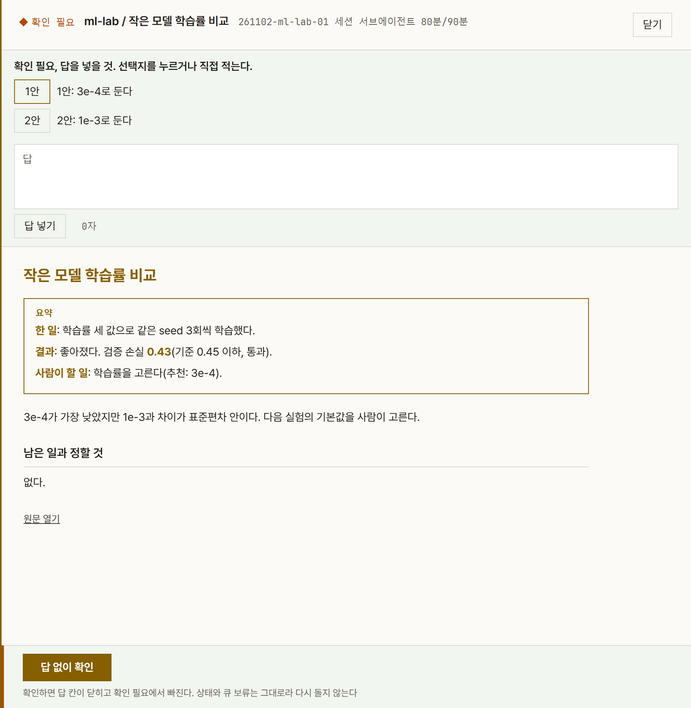
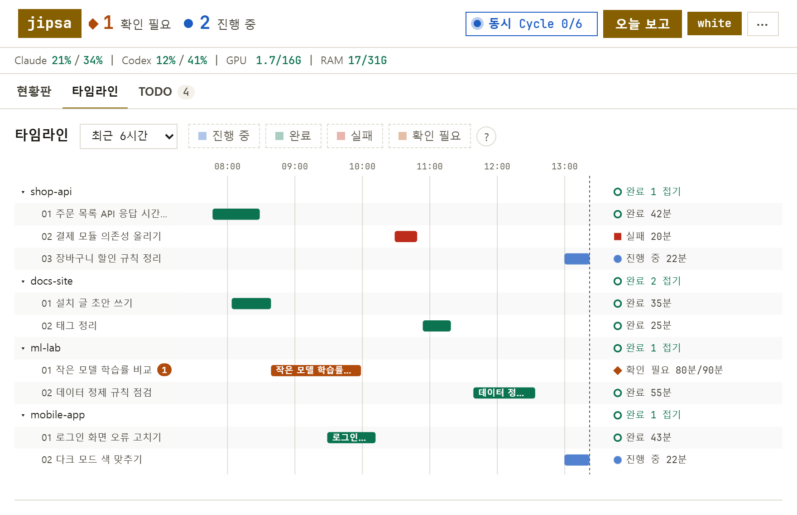
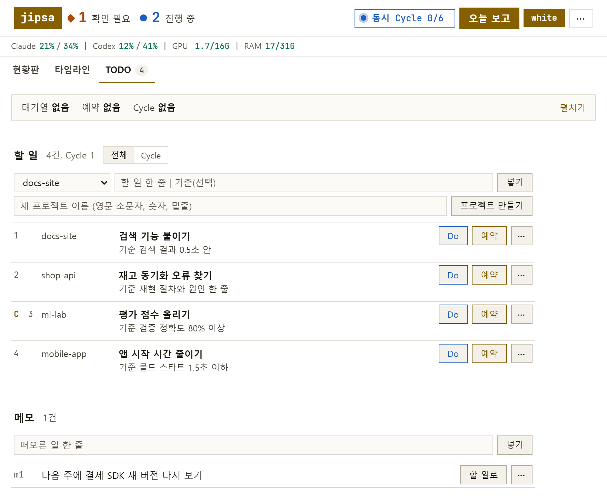

<div align="center">

# jipsa

**여러 저장소의 Claude Code 작업을 한 화면에서 넣고, 돌리고, 기록하고, 보고하는 1인용 작업 허브**

  

한국어 | English(준비 중)


</div>

jipsa는 Claude Code 세션에서 말로 일을 시키면, 저장소마다 worktree를 만들어 작업자가 기능 브랜치 커밋까지 하고, 결과를 대시보드 결과지 한 장과 Slack 한 줄로 돌려주는 도구다. 엔진 없이 등록부 파일, 할당 파일, 루프 하나, Slack Incoming Webhook만으로 돈다. 명령 이름은 `jipsa`다.

## 왜 만들었나

Claude Code를 여러 저장소에서 동시에 돌리면 무엇이 어디까지 됐는지, 어떤 결정을 기다리는지 놓친다. jipsa는 실행 주체가 스케줄러든 세션의 서브에이전트든 같은 모양의 기록을 남기고, 사람이 정할 것만 결과지에 모은다.

- **되돌릴 수 있는 데까지만 한다.** 기능 브랜치 커밋까지가 자동 범위다. 푸시, 병합, 발행은 사람이 직접 지시할 때만 한다.
- **만드는 쪽과 검토하는 쪽이 다르다.** Claude Code가 만들고 Codex CLI가 보고서를 반대 검토한다(선택).
- **사람에게 묻지 않고 결과지로 넘긴다.** 정할 것은 확인 필요 상태와 선택지로 남고, 대시보드에서 고른다.
- **목표가 있으면 이어 돈다.** Cycle은 지표와 목표값을 받아 실행, 분석, 다음 플랜을 마감까지 되풀이한다.

## 빠른 시작

요구 사항은 Windows 11, Python 3.12, [uv](https://docs.astral.sh/uv/), git, Claude Code CLI다. Codex CLI, Ollama, NVIDIA GPU는 선택이다.

```powershell
git clone <이 저장소> jipsa
cd jipsa
uv sync
uv run jipsa web              # 대시보드 http://127.0.0.1:8765/ (터미널을 차지한다)
claude                        # 다른 터미널의 같은 폴더에서
```

받은 폴더에서 Claude Code를 켜면 세션이 안내, 스킬, 훅을 읽으므로 복사할 파일은 없고, 지울 때도 폴더만 지우면 된다([제거](docs/getting-started.md#제거)). 처음 열 때 폴더 신뢰 확인에 동의한다. 세션에서 저장소를 하나 등록한 뒤 일을 넣는다.

```text
/jipsa-register my_app
/todo my_app 로그인 오류 고치기 | 로그인 테스트 통과
/todo run 1
```

Slack, Codex, 상태줄처럼 필요할 때만 하는 단계, 임시 폴더로 화면만 먼저 보는 방법, 설정 스킬은 [설치와 첫 실행](docs/getting-started.md)이다. 훅이 턴 끝을 막거나 코드 수정을 거절하는 이유와 끄는 법은 [Claude Code 연계](docs/claude-code.md)다.

## 화면 둘러보기

> 아래 화면은 가짜 프로젝트 네 개(shop-api, docs-site, ml-lab, mobile-app)를 등록한 임시 등록부와 임시 상태 폴더로 찍은 대시보드의 화이트 모드다. 이 저장소에 그 등록부는 없다. 스케줄러를 띄우지 않는 미리보기라 위 줄에 스케줄러 꺼짐과 웹훅 없음이 보이고, 위 줄의 사용량과 로고 이름은 공개용 예시로 바꿔 찍었다.

**현황판.** 저장소마다 진행 중인 작업, 최근 결과, 미병합 브랜치 수를 한 칸에 보인다. 위 줄은 Claude와 Codex 사용량, GPU와 RAM이다. 화면 모드는 기본이 화이트이고 오른쪽 위 버튼 하나에 지금 모드가 보이고 누르면 다른 모드로 뒤집힌다.


**결과지 서랍.** 작업 하나를 열면 요약 상자(한 일, 결과, 사람이 할 일), 근거, 정할 것이 나온다. 확인 필요 작업은 위에 선택지와 답 칸이 붙는다.



**타임라인.** 최근 몇 시간의 작업을 저장소별 막대로 보인다. 진행 중, 완료, 실패, 확인 필요를 색으로 가른다.



**TODO.** 할 일 줄과 메모를 넣고 대기열, 예약, Cycle 상태를 본다. 넣기만 해서는 돌지 않고 시킨 줄만 돈다.



## 구조

사람은 세션과 대시보드에서 일을 넣고 고르며, 실행은 저장소마다 worktree에서 돌고 기록은 한 곳에 모인다.


작업 한 건은 완료 기준을 받은 뒤 단계마다 증거를 남기고, 반대 검토를 거쳐 결과지 한 장으로 끝난다.


## 명령

| 명령 | 하는 일 |
| --- | --- |
| `jipsa web` | 대시보드를 띄운다 |
| `jipsa run` | 스케줄러를 돌린다 |
| `jipsa todo` | 할 일 줄과 메모를 넣고 시킨다 |
| `jipsa registry` | 프로젝트 등록을 보고 만들고 고친다 |
| `jipsa settings` | 전역 설정을 보고 쓰고 되돌린다 |
| `jipsa begin`, `jipsa finish` | 세션 서브에이전트 작업의 시작과 마감 |
| `jipsa attack` | 마감 전 반대 검토를 돌린다. 공급자는 설정에서 codex, claude, none 가운데 고른다 |
| `jipsa runs`, `jipsa result` | 지난 작업 목록과 결과지 전문 |
| `jipsa status`, `jipsa report` | 지금 상태와 오늘 보고 |
| `jipsa check` | 환경 점검. Codex, GPU, Slack, AGENTS.md는 선택 항목이라 없어도 종료 코드가 0이다 |
| `python monitor.py` | 콘솔 Monitor. 대시보드와 스케줄러를 한 단축키로 함께 켜고, 끄고, 다시 켠다 |

## 폴더

| 폴더 | 내용 |
| --- | --- |
| `scheduler/` | 명령, 스케줄러 루프, 기록, 보고, 대시보드 서버 |
| `web/` | 대시보드 화면 |
| `adapters/`, `notify/`, `hooks/` | Claude Code와 Codex 호출, Slack 송신, 세션 훅 |
| `projects/` | 등록부. 저장소마다 자동 범위와 금지 행동을 적는다 |
| `policies/` | 보고서 규격, 추천안 범위, 작업자 권한 설정 |
| `.claude/`, `CLAUDE.md` | 세션이 읽는 훅 설정, 스킬 8개, 안내 |
| `RULES.md` | 작업자에게 붙는 공통 규칙 |

`runs/`, `reports/`, `runtime/`, `worktrees/`는 실행 중에 생기며 git에 넣지 않는다.

## 문서

- [설치와 첫 실행](docs/getting-started.md)
- [등록부 형식](docs/registry.md)
- [할 일 파일 형식](docs/todo.md)
- [Claude Code 연계(훅, 상태줄, 스킬)](docs/claude-code.md)

## 한계

- Windows 11에서만 확인했다. 경로 처리와 창 숨김이 Windows 기준이다.
- 1인 1대 기준이다. 여러 사람이 같은 대시보드를 쓰는 경우는 다루지 않는다.

## 라이선스

MIT 라이선스다. [LICENSE](LICENSE)를 본다.
