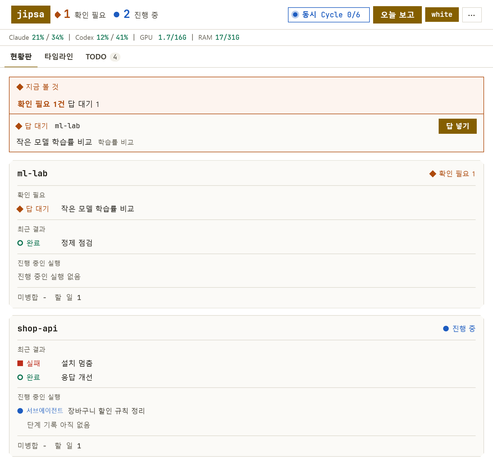
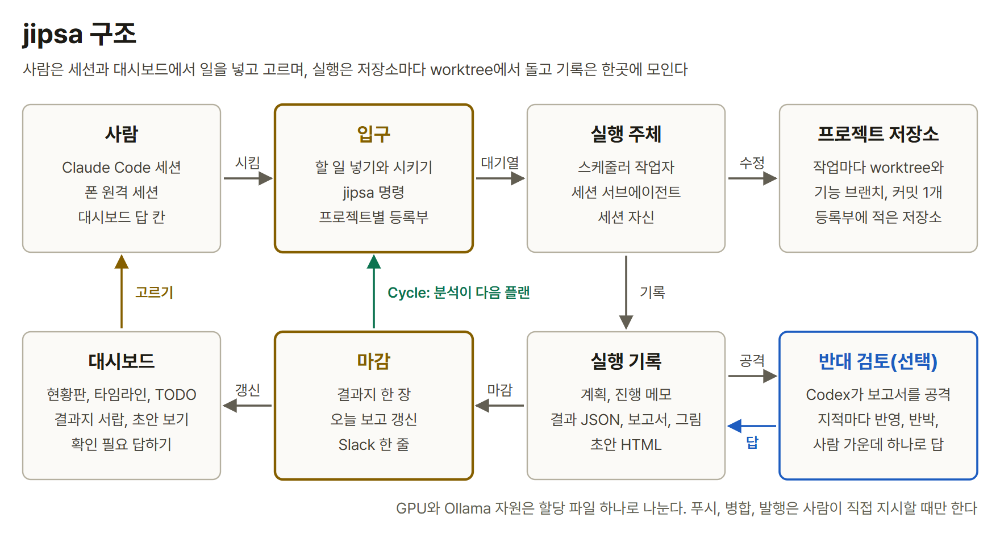
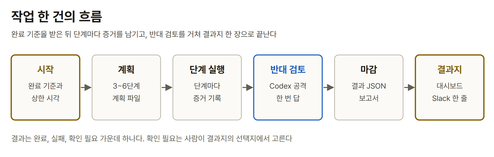

<div align="center">

# jipsa

**여러 저장소의 Claude Code 작업을 대시보드 한 화면에서 넣고, 돌리고, 고르는 1인용 작업 허브**

  

[한국어](README.md) | [English](README.en.md)



</div>

jipsa는 대시보드에 일을 적고 Do를 누르면 저장소마다 worktree를 만들어 작업자가 기능 브랜치 커밋까지 하고, 결과를 결과지 한 장과 Slack 한 줄로 돌려주는 도구다. 명령은 설치와 세팅에만 쓰고 나머지는 대시보드에서 한다.

## 특징

- **되돌릴 수 있는 데까지만 한다.** 기능 브랜치 커밋까지가 자동 범위다. 푸시, 병합, 발행은 사람이 직접 지시할 때만 한다.
- **만드는 쪽과 검토하는 쪽이 다르다.** Claude Code가 만들고 Codex CLI가 보고서를 반대 검토한다(선택).
- **사람에게 묻지 않고 결과지로 넘긴다.** 정할 것은 확인 필요와 선택지로 남고, 대시보드에서 고른다.
- **목표가 있으면 이어 돈다.** Cycle은 지표와 목표값을 받아 실행, 분석, 다음 플랜을 마감까지 되풀이한다.
- **저장소마다 따로 일한다.** 작업은 worktree에서 돌아 원본 폴더를 건드리지 않고, 기록은 한 곳에 모인다.

## 빠른 시작

Windows 11에 [uv](https://docs.astral.sh/uv/), git, Claude Code CLI가 있으면 명령 다섯 줄로 대시보드가 열린다. Python 3.12는 uv가 찾거나 받아 온다. Codex CLI, Ollama, NVIDIA GPU, Slack은 선택이다.

```powershell
git clone <이 저장소> jipsa
cd jipsa
uv sync
uv run jipsa check
uv run jipsa web
```

http://127.0.0.1:8765/ 에서 **TODO** 탭을 열어 프로젝트 이름을 넣고 **프로젝트 만들기**를 누른다. 만들어진 줄에 할 일을 적고 **Do**를 누르면 작업자가 기능 브랜치에서 일하고, 끝나면 결과지가 확인 필요 목록에 올라온다. 가상환경과 훅, 폴더 신뢰, Slack, 상태줄, Monitor, 설정 스킬, 제거는 [설치와 첫 실행](docs/getting-started.md)에 있고, 단추별 사용법은 [대시보드 사용](docs/dashboard.md)에 있고, 초안 보기와 밤새 도는 Cycle은 그 안의 예시로 따라 할 수 있다.

Slack으로 결과를 받으려면 jipsa 폴더의 Claude Code 세션에서 `/jipsa-slack`을 입력하고 Slack 연결 주소(Webhook URL)를 붙여 넣는다. 확인 필요와 실패는 끝나는 대로 한 줄 묶음으로 오고, 아침 요약은 밤사이 끝난 Cycle을 모아 하루 한 번 온다. 시험 글 보내기와 보내는 때는 [Slack 알림](docs/dashboard.md#7-slack-알림)에 있다.

## 구조

사람은 대시보드에서 일을 넣고 고르며, 실행은 저장소마다 worktree에서 돌고 기록은 한 곳에 모인다.



작업 한 건은 완료 기준을 받은 뒤 단계마다 증거를 남기고, 반대 검토를 거쳐 결과지 한 장으로 끝난다.



<details markdown="1">
<summary>폴더 구성</summary>

| 폴더 | 내용 |
| --- | --- |
| `scheduler/` | 명령, 스케줄러 루프, 기록, 보고, 대시보드 서버 |
| `web/` | 대시보드 화면 |
| `adapters/`, `notify/`, `hooks/` | Claude Code와 Codex 호출, Slack 송신, 세션 훅 |
| `projects/` | 등록부. 저장소마다 자동 범위와 금지 행동을 적는다 |
| `policies/` | 보고서 규격, 추천안 범위, 작업자 권한 설정 |
| `.claude/`, `CLAUDE.md` | 세션이 읽는 훅 설정, 스킬 8개, 안내 |
| `RULES.md` | 작업자에게 붙는 공통 규칙 |
| `pyproject.toml`, `uv.lock` | 의존성과 `jipsa` 명령 진입점, 고정한 패키지 버전 |

`.venv/`, `runs/`, `reports/`, `runtime/`, `worktrees/`는 실행 중에 생기며 git에 넣지 않는다.

</details>

## 문서

- [대시보드 사용](docs/dashboard.md): 프로젝트 만들기, 작업 시키기, 진행 보기, 확인 필요 처리, 초안 보기, Cycle, Slack 알림
- [설치와 첫 실행](docs/getting-started.md): 가상환경, 훅, Monitor, 설정 스킬, 제거
- [등록부 형식](docs/registry.md)
- [할 일 파일 형식](docs/todo.md)
- [Claude Code 연계(훅, 상태줄, 스킬)](docs/claude-code.md)

## 한계와 라이선스

- Windows 11에서만 확인했다. 경로 처리와 창 숨김이 Windows 기준이다.
- 1인 1대 기준이다. 여러 사람이 같은 대시보드를 쓰는 경우는 다루지 않는다.

MIT 라이선스다. [LICENSE](LICENSE)를 본다.
