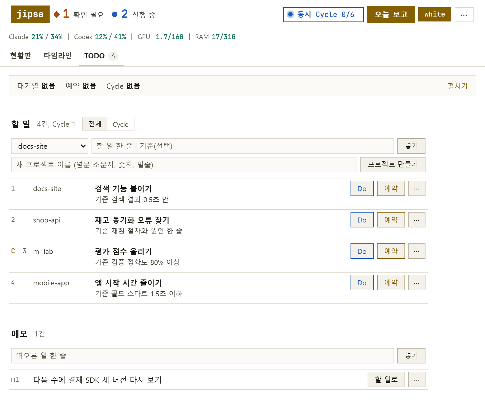
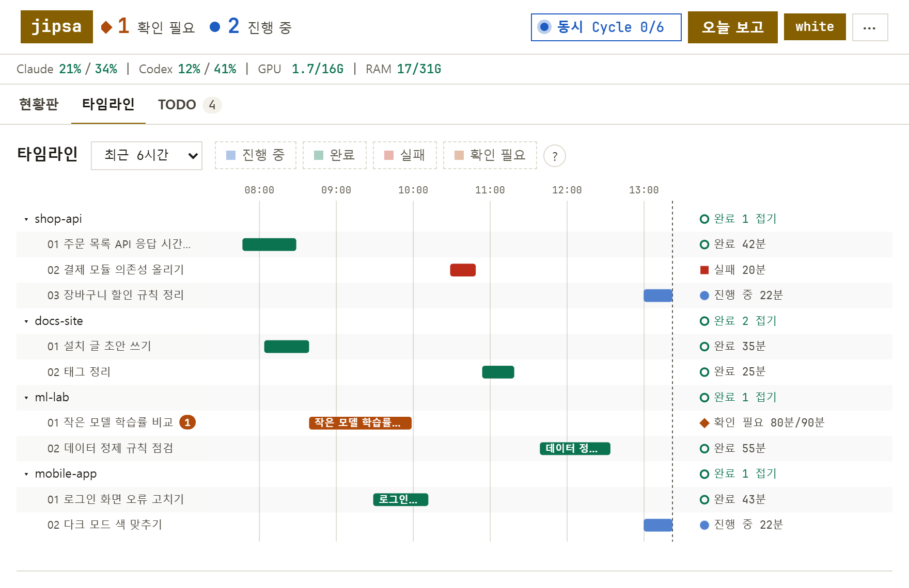
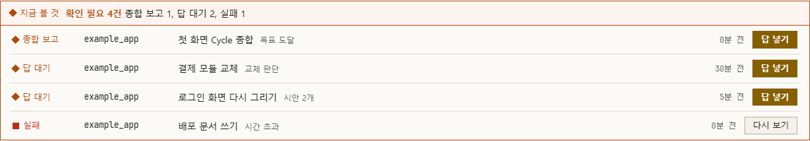
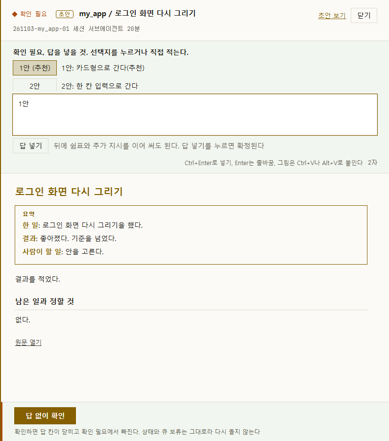
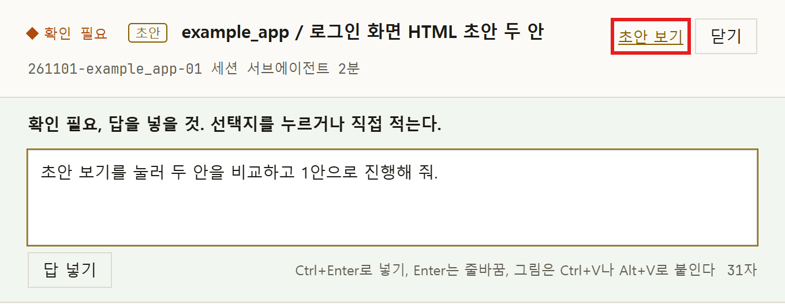
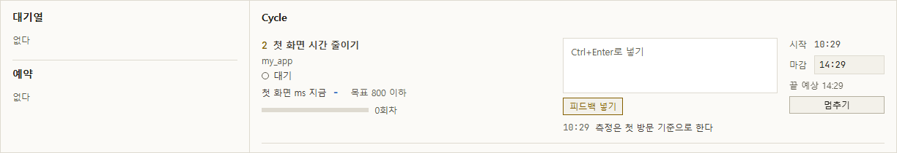

# 대시보드 사용

대시보드는 프로젝트를 만들고, 일을 넣고, 진행을 보고, 사람이 정할 것에 답하는 화면이다. 이 문서는 단추와 화면별로 하는 일과 경우별 동작을 적는다. 설치와 첫 실행은 [설치와 첫 실행](getting-started.md)을 먼저 본다.

- [1. 프로젝트 만들기](#1-프로젝트-만들기)
- [2. 작업 시키기](#2-작업-시키기)
- [3. 진행 보기](#3-진행-보기)
- [4. 확인 필요 처리](#4-확인-필요-처리)
- [5. 초안 보기](#5-초안-보기)
- [6. Cycle](#6-cycle)
- [7. Slack 알림](#7-slack-알림)

## 1. 프로젝트 만들기

대시보드나 Claude Code 세션 어느 쪽에서든 프로젝트 이름 하나로 만든다. 묻는 것은 없다.

- 대시보드: **TODO** 탭의 **할 일** 칸 아래 입력에 `my_app`처럼 이름을 넣고 **프로젝트 만들기**를 누른다. 결과와 오류는 입력 아래 한 줄로 보인다.
- 세션: 이 폴더에서 연 Claude Code 세션에 한 줄을 넣어도 같다.

```text
/jipsa-register my_app
```

만들어지는 것은 아래와 같다.

- jipsa 폴더와 나란히 `my_app` 폴더가 생기고 git 첫 커밋과 등록까지 끝난다.
- 종류는 code이고 자동 범위는 기능 브랜치 커밋까지다.

경우별 동작은 아래와 같다.

| 경우 | 동작 |
| --- | --- |
| 같은 이름의 폴더가 이미 있다 | 건드리지 않고 그 폴더를 등록한다 |
| 그 폴더가 git 저장소가 아니다 | 첫 커밋을 하라는 주의 한 줄이 나온다 |
| 이름이 영문 소문자, 숫자, 밑줄이 아니다 | 오류 한 줄로 끝난다 |
| 이미 등록된 이름이다 | 오류 한 줄로 끝난다 |

등록한 값을 고치려면 `/jipsa-register my_app edit`, 보려면 `/jipsa-register my_app show`를 쓴다.

## 2. 작업 시키기

작업은 **TODO** 탭에서 넣고 시킨다. 넣기만 해서는 돌지 않고 **Do**를 눌러야 돈다.



1. **할 일** 칸 왼쪽 목록에서 프로젝트를 고른다. 대시보드에서 만든 프로젝트는 바로 골라져 있고, 세션에서 만든 프로젝트는 곧 목록에 나타난다.
2. 입력 칸에 `로그인 오류 고치기 | 로그인 테스트 통과`처럼 할 일과 완료 기준을 적고 **넣기**를 누른다. 기준은 선택이고, 비우면 기준 후보를 정하는 작업이 먼저 돈다.
3. 줄 끝 **Do**를 누르고 확인 창에 동의한다. 줄은 할 일에서 빠지고 "스케줄러에 넣는 중"으로 보인 뒤 현황판에 들어간다.

시각을 정해 돌리거나 줄을 정리하는 방법은 아래와 같다.

- 정한 시각에 돌리기: **예약**을 눌러 시각(`22:00`, `+30m`)을 적고 **예약하기**를 누른다.
- 줄 지우기: 줄 끝 ⋯ 메뉴의 **지우기**를 누른다.
- 아직 할 일이 아닌 생각: 아래 **메모**에 넣어 두고 나중에 **할 일로** 올린다.
- 누가 돌리나: 열린 Claude Code 세션이 답을 기다리는 중이면 Do는 그 세션의 서브에이전트로 가고, 아니면 스케줄러 작업자로 간다.

## 3. 진행 보기

맨 위 줄의 숫자가 지금 확인 필요와 진행 중 수이고, 옆에 지금 도는 일이 보인다. 자세히 보는 곳은 두 탭이다.

- **현황판**: 프로젝트마다 카드 한 장에 확인 필요, 최근 결과, 진행 중인 실행, 미병합 브랜치 수, 할 일 수를 보인다. 일이 없는 프로젝트는 아래 **쉬는 프로젝트**에, 오늘 결과는 **오늘 끝난 일**에 있다.
- **타임라인**: 프로젝트와 작업마다 막대 한 줄이다. 색이 상태이고 위 칩(**진행 중**, **완료**, **실패**, **확인 필요**)으로 거른다. 막대에 마우스를 올리면 단계 이름이 보이고, 누르면 결과지가 열린다.



그날 전체는 오른쪽 위 **오늘 보고**에서 본다.

## 4. 확인 필요 처리

작업자는 사람에게 묻지 않고 멈춰서 결과지로 넘긴다. 끝났는데 아직 보지 않은 결과도 확인 필요로 모인다.

### 어디에 보이나

- 맨 위 줄의 **확인 필요** 숫자. 누르면 현황판 목록으로 간다.
- **현황판** 위 **지금 볼 것** 띠와 그 아래 목록.
- **타임라인**의 주황 막대와 숫자 표식. 실패는 빨간 막대다.



| 목록의 종류 | 뜻 | 줄 끝 단추 |
| --- | --- | --- |
| 답 대기 | 사람이 정해야 작업이 나아간다 | 답 넣기 |
| 종합 보고 | Cycle이 끝나 전체 결과를 냈다 | 답 넣기 |
| 실패 | 작업이 실패했고 아직 보지 않았다 | 다시 보기 |
| 확인 필요 | 끝났고 아직 보지 않았다 | 결과지 |

### 결과지 서랍

단추나 막대를 누르면 오른쪽에 결과지 서랍이 열린다. 위에 답 칸, 가운데 보고서, 바닥에 확인 단추가 있다. 보고서 맨 위 요약 상자가 한 일, 결과, 사람이 할 일을 세 줄로 말한다. 끝에 **원문 열기**가 있다.



### 선택지 고르기

선택지 단추를 누르면 답 칸에 안 이름이 채워지지만 확정되지는 않는다.

1. `1안 (추천)`, `2안` 단추를 누른다. 답 칸에 안 이름이 채워진다.
2. 필요하면 뒤에 `1안, 버튼 색은 파랑으로`처럼 지시를 이어 쓴다.
3. **답 넣기**를 누르면 확정된다.

### 답 넣기

답 칸에 직접 적고 **답 넣기**(Ctrl+Enter)를 누른 뒤 확인 창에 동의한다. Enter는 줄바꿈이고, 그림은 Ctrl+V나 Alt+V로 붙인다.

### 답이 처리되는 방식

답을 넣으면 대시보드가 작업을 이어 간다. 이어 가는 방식은 작업 주체에 따라 세 경우로 갈린다.

- 스케줄러 작업자의 답 대기: 스케줄러가 답을 받아 같은 작업을 이어 돌린다. 세션을 열어 둘 필요가 없다.
- 세션 서브에이전트 작업과 이미 끝난 결과: 그 실행을 다시 돌리지 않고 답을 Claude Code 세션에 넘긴다. 세션이 2분 안에 받지 않으면 스케줄러가 새 작업자 실행으로 넘겨 앞 결과지와 답을 읽고 잇는다. 그래서 대시보드만 써도 답이 처리된다. 작업자는 그 프로젝트 등록부의 허용 범위 안에서만 일하고, 범위 밖이면 확인 필요로 돌아온다.
- 자동으로 넘어가지 않는 답: 세션 전용 프로젝트(`manual_only`)의 답과 1시간 넘게 묵은 답(스케줄러가 꺼져 있던 사이의 답)은 세션이 받을 때까지 기다린다. 결과지에 "아직 처리되지 않았다"는 줄과 사유가 보인다. 묵은 답을 지금 돌리려면 `uv run jipsa answer <실행ID> --undo`로 물린 뒤 다시 넣는다.

### 답 없이 확인

읽기만 하고 정하지 않을 때 서랍 바닥 단추를 누른다.

- **답 없이 확인**(답 대기 작업): 답 칸이 닫히고 확인 필요에서 빠지며 상태가 **확인함**이 된다. 작업은 다시 돌지 않는다.
- **확인**(끝난 결과): 확인 필요에서 빠진다. 실패도 확인하면 완료로 처리되고 원래 사유는 결과지에 남는다.
- **확인 필요로 되돌리기**: 확인한 뒤 바닥에 나온다. 누르면 확인 필요로 돌아오고 답 칸이 다시 열린다.

## 5. 초안 보기

초안은 보고서와 따로 작업자가 만든 HTML 결과물이다. 보고서가 무엇을 했고 무엇을 정할지 말한다면, 초안은 화면 시안이나 문서 시안처럼 사람이 눈으로 보고 고를 실물이다. 실행 폴더 안에 저장된다.

### 만들기

할 일에 `로그인 화면 HTML 초안 두 안`처럼 적고 **Do**를 누른다. 문장이나 기준에 초안이 있으면 초안 작업으로 돈다. 작업자가 만든 HTML 경로가 결과 파일의 `preview_url`에 없으면 끝나지 않는다.

- 스케줄러 작업자: 한 번 돌려보내고, 그래도 비면 확인 필요로 끝난다.
- 세션: 마감이 막힌다.

초안으로 치지 않는 줄은 아래와 같다.

- `초안 보기 고쳐 줘`처럼 기능을 말하는 문장
- `설계초안.md`처럼 파일 이름
- `지난 초안 읽고 요약해 줘`처럼 있는 초안을 읽는 문장
- Cycle 줄

### 열기와 고르기

- 열기: 서랍 오른쪽 위 **닫기** 옆 **초안 보기**를 누르면 새 탭에서 열린다. 실행 폴더 안의 파일은 대시보드가 내준다. 그 밖의 `file:` 주소는 브라우저가 막으므로 누르면 주소를 복사하고, 그 주소를 주소창에 붙여 넣는다.
- 고르기: 초안을 본 뒤 서랍으로 돌아와 선택지를 고르거나 답을 넣는다.

### 예시: 초안 열고 고르기

아래 결과지는 초안이 있는 작업의 서랍이다. 빨간 상자가 누를 단추다.



1. 확인 필요 목록에서 제목 앞에 **초안** 표식이 붙은 줄의 **답 넣기**를 눌러 서랍을 연다.
2. 서랍 오른쪽 위 빨간 상자 안의 **초안 보기**를 누른다. 이 단추를 누르면 초안이 새 탭에서 열린다.
3. 새 탭에서 초안을 보고, 여러 안이면 탭이나 절을 눌러 견준다.
4. 서랍 탭으로 돌아와 선택지 단추나 답 칸으로 고른다. 예를 들어 `2안, 제목은 더 짧게`를 적고 **답 넣기**를 누른다.

### 표시

초안으로 돈 작업은 제목 앞과 **오늘 끝난 일** 줄에 **초안** 표식이 붙는다. 주소가 비면 **초안 주소 없음**, 미리보기 서버가 응답하지 않으면 **미리보기 꺼짐**이 보인다.

## 6. Cycle

Cycle은 지표와 목표값을 주면 실행, 분석, 다음 플랜을 마감까지 되풀이하는 작업이다. 순서는 일회성 작업과 같고 모두 TODO 탭에서 시작한다.

### 목표 넣기

세 방법 가운데 하나를 쓴다.

- 넣을 때 적는다: `첫 화면 시간 줄이기 | 첫 화면이 0.8초 안에 뜬다 | cycle 첫 화면 ms 800 이하 상한 4`. `상한 N`은 나아지지 않은 Cycle을 몇 번 연속까지 볼지이고 선택이다.
- 넣은 줄을 바꾼다: 줄 끝 ⋯ 메뉴의 **Cycle**을 누른다. 지표와 목표값은 첫 분석이 정해 그 줄에 채운다. 다시 누르면 꺼진다.
- 값을 고친다: 줄 끝 ⋯ 메뉴의 **Cycle 값 고치기**를 누르고 지표, 목표값, 방향, 상한, 끝 조건을 고쳐 **저장**한다. 비운 칸은 첫 분석이 정한다. 도는 줄은 "도는 중이다"로 거절되고 값이 그대로다. **멈추기**로 줄이 할 일로 돌아온 뒤 고치고 **Do**로 잇는다.

Cycle 줄은 번호 왼쪽에 **C**가 붙고, 마우스를 올리면 지표와 목표값이 보인다. **할 일** 머리의 **Cycle** 단추로 이 줄만 볼 수 있다.

### 시작과 마감 정하기

- 지금 시작: **Do**를 누르면 줄 아래 **마감** 칸이 열린다. 기본값은 `07:00`이고 `+4h`처럼도 적는다. **시키기**를 누른다.
- 나중에 시작: **예약**을 누르고 **시각**과 **마감**을 적은 뒤 **예약하기**를 누른다. 예약은 위 띠를 펼쳐 **빼기**로 거둔다.

### 진행 보기

TODO 맨 위 띠의 **펼치기**를 누르면 **대기열**, **예약**, **Cycle** 칸이 나온다. Cycle 칸에는 지금 단계, 지표의 지금 값과 목표, 회차, 시작에서 마감까지 지난 비율, 회차별 값 그래프가 있다.



**타임라인**에는 목표 줄이 생겨 처음 값, 최고 값, 목표, 지금 위치를 보이고 그 아래에 회차별 막대가 놓인다. **현황판** 카드에는 **Cycle 목표**가 보인다.

### 피드백과 마감 고치기

- 피드백: Cycle 칸의 글 칸에 적고 **피드백 넣기**(Ctrl+Enter)를 누른다. 돌고 있는 단계에는 다음 구간부터 닿고 다음 분석과 명령에도 들어간다. 지표와 목표값은 바뀌지 않는다.
- 마감: Cycle 칸의 **마감** 값을 `HH:MM`이나 `+2h`로 고치고 Enter를 누른다. 돌던 단계는 끊지 않는다.

### 멈추기

Cycle 칸의 **멈추기**를 누르고 확인 창에 동의한다. 돌던 단계는 끝까지 두고 마감 결과지를 쓴 뒤 줄이 할 일로 돌아온다. 한 번 돈 줄은 **할 일** 머리의 **지난 Cycle**에 있고, **Do**를 누르면 멈춘 자리부터 잇는다.

### 예시: 밤새 돌리는 Cycle

`my_app`의 첫 화면 시간을 밤사이 줄이는 경우다. 할 일 줄은 아래처럼 쓴다. 대시보드는 프로젝트를 `my_app`으로 고르고 입력에 `my_app |` 뒤를 적어 **넣기**를 누르며, 세션은 `/todo my_app 첫 화면 시간 줄이기 | ...`로 넣는다.

```text
my_app | 첫 화면 시간 줄이기 | 첫 화면이 0.8초 안에 뜬다 | cycle 첫 화면 ms 800 이하 상한 4
```

- 지표는 `첫 화면 ms`, 목표값은 `800`, 방향은 `이하`다.
- `상한 4`는 나아지지 않은 Cycle이 연속 4번이면 멈춘다는 뜻이다.
- `도달하면 끝`을 적지 않았으므로 800ms에 닿아도 마감까지 이어 돈다.

`/todo`로 줄 번호가 3번이라고 보이면 시작과 마감을 붙여 시킨다. 대시보드는 3번 줄 끝 **Do**를 누르고 **마감** 칸에 `07:00`을 적어 **시키기**를 누르며, 시작 시각은 **예약**에 적는다.

```text
/todo run 3 시작 22:00 마감 07:00
```

| 때 | 일어나는 일 |
| --- | --- |
| 22:00 | Cycle 1이 시작되어 첫 화면 시간을 줄이는 일을 실행한다 |
| 회차 끝 | 분석이 지표를 재서 목표값과 견주고, 나아졌는지 판정한 뒤 다음 플랜을 쓴다 |
| 다음 회차 | 그 플랜으로 Cycle 2, 3, ...이 이어 돈다. 나아지지 않은 회차가 연속 4번이면 끝난다 |
| 다음 날 07:00 | 돌던 단계는 끝까지 두고 마감 결과지를 쓴 뒤 멈춘다 |
| 아침 | **종합 보고**가 확인 필요에 떠 있다. 읽기만 했으면 **확인**, 덧붙일 지시가 있으면 답 칸에 적는다 |

도는 동안 TODO 맨 위 띠의 **Cycle** 칸에서 회차별 값 그래프를 보고, 마음이 바뀌면 `/todo stop 3`이나 **멈추기**로 끝낸다.

### 끝난 결과지 보기

끝나면 현황판 목록과 타임라인 목표 줄 아래에 **종합 보고**가 확인 필요로 뜬다. **답 넣기**를 눌러 서랍을 열고, 읽기만 했으면 바닥 **확인**, 덧붙일 지시가 있으면 답 칸에 적어 **답 넣기**를 누른다. 지난 회차의 단계도 타임라인 막대를 눌러 결과지로 본다.

## 7. Slack 알림

Slack 알림은 Slack 연결 주소(Webhook URL)를 한 번 넣으면 켜진다. 주소는 비밀값이라 화면, 문서, 기록 어디에도 적지 않는다. 주소가 없으면 보고는 보고 폴더에만 남고 대시보드 머리 줄에 **Slack 연결 안 됨**이 뜬다.

### 주소 넣기

1. Slack에서 글을 받을 채널의 Incoming Webhook 주소를 만든다. 이 주소가 Slack 연결 주소다.
2. jipsa 폴더에서 Claude Code 세션을 켜고 `/jipsa-slack`을 입력한다.
3. 첫 질문에 주소를 붙여 넣는다. 주소는 바로 저장되고 채팅에 다시 적히지 않는다. 지금 값은 설정됨이나 없음으로만 보인다.
4. 시험 글을 보낼지 묻는 질문에 예라고 답한다(아래 시험 글 보내기).
5. 아침 요약 시각(기본 07:30)과 알림 켜짐을 답하고, 바뀐 칸을 보고 저장에 동의한다.

`.env`의 `JIPSA_SLACK_WEBHOOK`에 적어도 같다. 이 경우 `.env` 값이 앞서므로 바꿀 때도 `.env`를 고친다. 주소를 지울 때는 `uv run jipsa settings webhook --clear`를 쓴다. 주소를 저장하면 머리 줄의 **Slack 연결 안 됨**은 곧 사라진다.

### 시험 글 보내기

`/jipsa-slack test`를 입력하면 시험 글 한 줄이 채널에 간다. 터미널에서는 `uv run jipsa settings slack-test`다. 글은 `[jipsa] 시험 글 14:05. 이 줄이 보이면 Slack 연결이 맞다`처럼 시각이 붙은 한 줄이고, 알림을 꺼 둔 때에도 간다. 채널에 보이지 않으면 Slack 연결 주소가 틀린 것이므로 다시 넣는다.

### 무엇이 언제 가나

| 때 | 가는 글 |
| --- | --- |
| 작업이 확인 필요나 실패로 끝날 때 | 끝나는 대로 한 글이 간다. 머리 줄, 요약 세 줄, 고를 것, 답하는 곳이 든다 |
| 작업이 완료로 끝날 때 | 보내지 않는다. 결과지는 대시보드에서 본다 |
| Cycle이 도는 동안 | 중간 단계는 보내지 않는다. 목표 정하기와 종합 보고만 간다 |
| 아침 요약 시각(기본 07:30) | 밤사이 끝난 Cycle을 모아 글 하나로 보낸다. 모을 것이 없으면 보내지 않는다 |
| 스케줄러가 멈추거나 꺼질 때 | 심장박동 멈춤, 꺼져서 다시 띄움, 연속으로 꺼져 다시 띄우기를 멈춤이 한 줄로 간다 |

### 켜고 끄기

대시보드 오른쪽 위 **...** 메뉴의 Slack 알림 스위치를 끄면 위 글이 가지 않고 시험 글만 간다. 같은 값이 `/jipsa-slack`의 마지막 질문이다. 지금 설정은 `/jipsa-slack show`로 보고, 주소와 알림 켜짐은 바로 반영된다. 아침 요약 시각을 바꿨을 때만 스케줄러를 다시 띄워야 한다.
